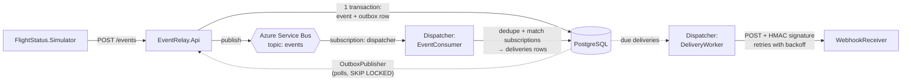

# EventRelay

[](../../actions/workflows/ci.yml)
[](../../actions/workflows/codeql.yml)


Reliable event delivery to subscribers over webhooks, built on .NET 10, PostgreSQL and Azure Service Bus.
Producers `POST` events once; EventRelay stores them, fans them out to every matching subscription
and delivers signed webhooks with retries, de-duplication and dead-lettering.
The demo domain is flight status updates (delays, gate changes, cancellations).

> **Learning / portfolio project.** It is built to explore and demonstrate reliability and security
> patterns (transactional outbox, idempotent consumers, at-least-once delivery, SSRF-safe webhooks,
> a written [threat model](docs/threat-model.md)).
> It is not a supported product. All airlines, airports and flights in the demo are fictional.

## Contents

- [How it works](#how-it-works)
- [Quick start](#quick-start)
- [Try it](#try-it)
- [Webhook format and signature](#webhook-format-and-signature)
- [Delivery guarantees](#delivery-guarantees)
- [Project structure](#project-structure)
- [Design decisions & trade-offs](#design-decisions--trade-offs)
- [Security considerations](#security-considerations) · [threat model](docs/threat-model.md) · [SECURITY.md](SECURITY.md)
- [Tests and CI](#tests-and-ci)
- [Infrastructure (Terraform)](#infrastructure-terraform)
- [Configuration](#configuration)
- [Roadmap](#roadmap)

## How it works



1. **Accept.** `POST /events` validates the event and writes it together with an outbox row in a
   single database transaction, then answers `202 Accepted`. The broker is not involved yet,
   so accepting events keeps working while Service Bus is down.
2. **Publish.** `OutboxPublisher` (a background service in the API) moves outbox rows to the
   `events` topic and marks them as published.
3. **Fan out.** `EventConsumer` in the dispatcher reads the topic, records the message id in
   `processed_messages` (idempotent consumer), matches subscriptions by event type and attributes,
   and creates one `deliveries` row per match, all in one transaction.
4. **Deliver.** `DeliveryWorker` claims due deliveries, POSTs the signed webhook and records the
   outcome: success, retry later (exponential backoff with jitter) or failed after N attempts.

More detail, including failure scenarios, is in [docs/architecture.md](docs/architecture.md)
and the ADRs in [docs/adr](docs/adr).

## Quick start

Requirements: Docker with Compose v2. Nothing else: no .NET SDK, no Azure account.

```bash
cp .env.example .env   # local credentials; replace the change-me values, e.g. with `openssl rand -hex 32`
docker compose up --build
```

No credentials are written in `docker-compose.yml`: compose reads them from `.env` (git-ignored)
and refuses to start while one is missing. All published ports are bound to `127.0.0.1`, so the
stack is not reachable from other machines on your network.

The first start downloads SQL Server (storage for the Service Bus emulator) and the .NET SDK
image, so it takes a few minutes. Then:

| What | Where |
| --- | --- |
| API reference (Scalar UI; enter a key from `.env` under *Authentication*) | http://localhost:8080/scalar |
| OpenAPI document | http://localhost:8080/openapi/v1.json |
| Health | http://localhost:8080/health |
| Last webhooks the sample receiver accepted | http://localhost:8081/received |

What happens on its own:

- `webhook-receiver` registers three subscriptions (with the admin key): all `flight.*` events,
  Contoso Air (`CT`) cancellations only, and delays sent to a deliberately **flaky** endpoint that
  fails 30% of requests with `503`.
- `simulator` publishes (with the publisher key) a random flight event every 3 seconds and
  occasionally re-sends the previous one to show that publishing is idempotent.
- `docker compose logs -f dispatcher webhook-receiver` shows fan-out, deliveries, retries on the
  flaky endpoint and signature checks.
- For the first ~30 seconds the API and dispatcher log `Service Bus not available yet` while the
  emulator boots. Events posted meanwhile wait in the outbox and go out as soon as it is ready:
  the outbox doing its job.

Stop with `docker compose down` (add `-v` to also drop the database volume).

## Try it

Every call needs an `X-Api-Key` header. The keys are the ones in your `.env`:

```bash
set -a; . ./.env; set +a   # load PUBLISHER_API_KEY and ADMIN_API_KEY into this shell

# Subscribe to delayed Contoso Air flights (admin key). The response contains the signing secret: shown once.
# The sample receiver does not know this generated secret, so it will reject these webhooks (see below).
curl -s -X POST http://localhost:8080/subscriptions -H "X-Api-Key: $ADMIN_API_KEY" \
  -H 'Content-Type: application/json' -d '{
  "name": "my delays",
  "eventTypes": ["flight.delayed"],
  "filter": { "airline": "CT" },
  "webhookUrl": "http://webhook-receiver:8080/webhooks/mine"
}'

# Publish an event (publisher key). Repeating the same request returns 200 with "duplicate": true.
curl -s -X POST http://localhost:8080/events -H "X-Api-Key: $PUBLISHER_API_KEY" \
  -H 'Content-Type: application/json' -d '{
  "id": "0b9f5bb5-61c1-4bd4-8b52-7a1c0c3b5d11",
  "type": "flight.delayed",
  "source": "manual",
  "attributes": { "airline": "CT", "flightNumber": "CT101" },
  "data": { "delayMinutes": 40 }
}'

# Where did it go? The receiver's own subscriptions "all flight events" and "delays (flaky endpoint)"
# end up Succeeded (the flaky one possibly after retries). "my delays" fails with lastError "http_401"
# and is Failed after 6 attempts (about a minute): the receiver cannot verify a signature made with a
# secret it does not know, and rejecting such a request is exactly what a subscriber should do.
curl -s http://localhost:8080/events/0b9f5bb5-61c1-4bd4-8b52-7a1c0c3b5d11/deliveries -H "X-Api-Key: $PUBLISHER_API_KEY"

# Hosts outside the allowlist are refused (here: the cloud metadata endpoint) -> 400
curl -s -X POST http://localhost:8080/subscriptions -H "X-Api-Key: $ADMIN_API_KEY" \
  -H 'Content-Type: application/json' -d '{
  "name": "nope", "eventTypes": ["*"], "webhookUrl": "http://169.254.169.254/latest/meta-data/"
}'

# No key -> 401; publisher key on an admin endpoint -> 403
curl -s -o /dev/null -w '%{http_code}\n' http://localhost:8080/subscriptions
curl -s -o /dev/null -w '%{http_code}\n' http://localhost:8080/subscriptions -H "X-Api-Key: $PUBLISHER_API_KEY"
```

The same requests are in [`src/EventRelay.Api/EventRelay.Api.http`](src/EventRelay.Api/EventRelay.Api.http).

**API overview**

| Method | Path | Key | Purpose |
| --- | --- | --- | --- |
| `POST` | `/events` | publisher | Accept an event (`202`, or `200` for a repeated id, `409` if the id belongs to a different event) |
| `GET` | `/events/{id}` | publisher | The stored event |
| `GET` | `/events/{id}/deliveries` | publisher | Delivery status per matching subscription |
| `POST` | `/subscriptions` | admin | Create; returns the secret once |
| `GET` | `/subscriptions`, `/subscriptions/{id}` | admin | Read (secrets are never returned) |
| `PUT` | `/subscriptions/{id}` | admin | Replace; pass `secret` to rotate it |
| `DELETE` | `/subscriptions/{id}` | admin | Delete, including its deliveries |
| `GET` | `/subscriptions/{id}/deliveries` | admin | Recent deliveries of a subscription |
| `GET` | `/health` | – | Database reachable |

An admin key can call everything a publisher key can. Without a valid key the API answers `401`,
with a key of the wrong role `403`.

Subscription patterns: an exact type (`flight.delayed`), a prefix wildcard (`flight.*`) or `*`.
The optional `filter` is a set of attribute values that must all be equal (case-sensitive).

## Webhook format and signature

```http
POST /webhooks/mine HTTP/1.1
Content-Type: application/json; charset=utf-8
User-Agent: EventRelay-Webhooks/1.0
X-Event-Id: 0b9f5bb5-61c1-4bd4-8b52-7a1c0c3b5d11
X-Event-Type: flight.delayed
X-Delivery-Id: 01a1efac-b1a8-704e-bd9b-0cd0b6d12905
X-Delivery-Attempt: 1
X-Timestamp: 1795029635
X-Signature: sha256=5f0c3c...e91a

{"id":"0b9f5bb5-...","type":"flight.delayed","source":"manual","time":"2026-11-18T17:20:35+00:00",
 "attributes":{"airline":"CT","flightNumber":"CT101"},"data":{"delayMinutes":40}}
```

`X-Signature` is `sha256=` + hex(HMAC-SHA256(secret, `"{X-Timestamp}.{raw body}"`)). A receiver should:

1. reject the request if `X-Timestamp` is more than a few minutes away from its clock (replays);
2. recompute the HMAC over the **raw** body bytes and compare in constant time;
3. de-duplicate by the `id` in the verified body, because delivery is at-least-once;
4. answer `2xx` quickly. Any other status, a redirect, or a timeout counts as a failed attempt.

Only `X-Timestamp` and the body are signed. `X-Event-Id`, `X-Event-Type` and the `X-Delivery-*`
headers are conveniences for logs and routing: anyone replaying a captured request within the time
window can change them, so take everything you rely on from the verified body. For the same reason,
never share one secret between subscriptions, or a request signed for one would verify on the other.

```csharp
var signed = Encoding.UTF8.GetBytes($"{timestamp}.").Concat(rawBody).ToArray();
var expected = HMACSHA256.HashData(Encoding.UTF8.GetBytes(secret), signed);
var provided = Convert.FromHexString(signatureHeader["sha256=".Length..]);
bool valid = CryptographicOperations.FixedTimeEquals(expected, provided);
```

The complete receiver side lives in [`samples/WebhookReceiver`](samples/WebhookReceiver/SignatureVerifier.cs).

## Delivery guarantees

- **At-least-once.** An accepted event is never lost: it is committed with its outbox row,
  published until the broker confirms, and delivered until the webhook confirms or attempts run out.
  The price is possible duplicates, which consumers absorb by de-duplicating on the event `id`.
- **No duplicate fan-out.** A redelivered broker message is recognised through `processed_messages`;
  a unique key on `(event_id, subscription_id)` backs it up. Each subscription gets one delivery per event.
- **Retries.** Exponential backoff with ±20% jitter: 5 s, 10 s, 20 s … capped at 5 min, 8 attempts
  in total by default (the compose demo uses 2 s, capped at 1 min, 6 attempts). Then the delivery is
  `Failed` and its last status code and error code are visible through the API.
- **Dead-lettering.** Broker messages that can never be processed (malformed JSON, unknown event)
  go straight to the subscription's dead-letter queue; messages that keep failing for other reasons
  are dead-lettered by Service Bus after 10 attempts, with a growing pause before each retry.
- **No ordering guarantee.** Events of the same flight may arrive out of order; the payload carries
  `time` so consumers can discard stale updates.

## Project structure

```
src/
  EventRelay.Core/            Domain, no package dependencies: Event, Subscription, Delivery,
                              SubscriptionMatcher, RetryPolicy, validation rules
  EventRelay.Infrastructure/  EF Core + PostgreSQL (migrations), outbox, Service Bus wrapper,
                              webhook sender (HMAC, allowlist, connect-time IP check)
  EventRelay.Api/             Minimal API (/events, /subscriptions, /health), API keys, OutboxPublisher
  EventRelay.Dispatcher/      Worker service: EventConsumer (fan-out) + DeliveryWorker
samples/
  FlightStatus.Simulator/     Publishes fictional flight.delayed / gate_changed / cancelled events
  WebhookReceiver/            Verifies signatures, de-duplicates, has a flaky endpoint
tests/
  EventRelay.Core.Tests/      Matcher, retry policy, delivery state machine, validation
  EventRelay.IntegrationTests/ Whole pipeline against real PostgreSQL + Service Bus emulator (Testcontainers)
infra/terraform/              Azure Container Apps, Service Bus, PostgreSQL (code only, never applied)
docs/                         Architecture, ADRs, threat model
docker/servicebus-emulator/   Topic/subscription definition for the emulator
```

## Design decisions & trade-offs

| Decision | Why | Cost / what production would add |
| --- | --- | --- |
| **Transactional outbox** ([ADR 001](docs/adr/001-transactional-outbox.md)) | No dual write: the event and "publish it" are one commit. API stays up when the broker is not. | Polling adds ~0.5 s latency and some DB load. CDC (logical replication) would remove polling. |
| **At-least-once + idempotent consumer** ([ADR 002](docs/adr/002-at-least-once-delivery.md)) | Exactly-once over HTTP is impossible; making duplicates harmless is cheap and honest. | Subscribers must de-duplicate. `processed_messages` and `events` need a retention job. |
| **Deliveries and retries in PostgreSQL**, not Service Bus scheduled messages | Status is queryable per event/subscription; retry policy is plain code; one claim query with `FOR UPDATE SKIP LOCKED` scales across instances. | The worker polls. Very high volumes would partition the table or move retries to the broker. |
| **Lease instead of long locks** | A claimed delivery gets `next_attempt_at = now + lease`; if the instance dies, it simply becomes due again. No transaction is held open during HTTP calls. | A webhook slower than the lease could be sent twice (still at-least-once). |
| **Shared database** for API and dispatcher | One schema, one migration path, FK integrity between events and deliveries. | The services are coupled through the schema; separate stores would need an event-carried model. |
| **Simple routing** (exact / prefix wildcard / `*` + attribute equality) | Predictable, indexable (GIN on `event_types`), unit-testable. | No expressions such as CloudEvents SQL; filters are case-sensitive. |
| **Migrations on API startup** | One-command demo; EF Core takes a database lock, so replicas do not race. | Production: run an EF migration bundle as a separate release step. |
| **Webhook allowlist + connect-time IP check** ([ADR 003](docs/adr/003-webhook-allowlist.md)) | Simplest effective SSRF control: host names on save and before every attempt, resolved IP addresses at connect time (closes DNS rebinding). | Every new subscriber host needs a config change. Production with self-service subscribers would add an egress proxy. |
| **No ordering** | Parallel delivery and retries; ordering would need sessions per key and head-of-line blocking. | Consumers use the event `time`. |
| **Static API keys with two roles** | Easy to run and to explain; least privilege for producers; keys rotate without downtime (several per role). | No per-tenant isolation. Production: OAuth 2.0 client credentials (Entra ID) and subscription ownership per tenant. |

## Security considerations

The full analysis, with each threat explained and what is deliberately left out, is in
[docs/threat-model.md](docs/threat-model.md). How to report a vulnerability: [SECURITY.md](SECURITY.md).

- **API keys with two roles.** Every endpoint except `/health` and the API description needs an
  `X-Api-Key` header: *publisher* keys send and read events, *admin* keys also manage subscriptions.
  Keys are compared as hashes in constant time, and authorization is deny-by-default (a fallback
  policy), so a newly added endpoint is protected even if someone forgets to say so.
- **SSRF-safe webhooks.** Webhook URLs are attacker-controlled input. Hosts must be on an allowlist
  (checked on save and before every attempt); at connect time every resolved IP address is checked
  and the socket connects only to those vetted addresses, so private, loopback, link-local and cloud
  metadata and platform addresses (`169.254.169.254`, Azure's `168.63.129.16`) are unreachable even
  through DNS rebinding. No proxy, no redirects, the response body is never read, and only
  relay-generated error codes (`http_503`, `timeout`, `address_not_allowed`) are recorded
  ([ADR 003](docs/adr/003-webhook-allowlist.md)).
- **Authenticity of webhooks.** Each subscription has its own 256-bit secret (generated unless
  supplied, returned only on creation, rotatable with `PUT`). The signature covers timestamp and
  body, so receivers can reject tampered and replayed requests (de-duplicating on the signed event
  id, not on a header).
- **No secrets in the repository.** Credentials live in `.env` (git-ignored; compose refuses to start
  without it) or in `dotnet user-secrets` for local runs; only `.env.example` with placeholders is
  committed. Terraform state, `*.tfvars` and plans are git-ignored. Enable GitHub **Secret scanning**
  and **Push protection** for the repository (Settings → Code security).
- **Nothing exposed by accident.** Published ports of the local stack bind to `127.0.0.1`; SQL Server
  publishes none.
- **Azure (Terraform).** PostgreSQL has no public endpoint (VNet integration, private DNS zone) and
  is reachable only from the Container Apps environment. Service Bus has SAS keys disabled; the apps
  use managed identities with least-privilege roles (the API can only send, the dispatcher only
  receive). The database password and API keys are generated and kept as Container Apps secrets.
  CI never authenticates to Azure.
- **Supply chain.** GitHub Actions are pinned to full commit SHAs with read-only permissions;
  Dependabot updates NuGet packages, actions, Docker images and Terraform providers; CodeQL scans
  the C# code and the workflows; NuGet audit fails the build on high or critical advisories.
- **Runtime hardening.** Containers run as a non-root user; request bodies are capped (256 KiB,
  event `data` ≤ 64 KiB); webhook calls have connect and total timeouts and do not keep cookies.

## Tests and CI

```bash
dotnet test --solution EventRelay.slnx   # needs the .NET 10 SDK and a running Docker
```

- **Unit tests** (`EventRelay.Core.Tests`): subscription matching (incl. a property-style check that
  the SQL pre-filter and the in-memory matcher agree), retry policy maths, the delivery state machine
  and validation rules.
- **Integration tests** (`EventRelay.IntegrationTests`): PostgreSQL and the Service Bus emulator run
  in Testcontainers; the API runs in-memory, the dispatcher in-process, the webhook target is a real
  HTTP server. Covered: an event reaches the webhook with a valid signature; a repeated POST and a
  redelivered broker message do not cause a second webhook; failures are retried and eventually
  succeed; deliveries fail after max attempts; redirects are not followed; filters and wildcards;
  hosts outside the allowlist are rejected at creation and at delivery time; malformed and orphaned
  messages are dead-lettered; requests without a key get `401` and publisher keys cannot manage
  subscriptions; private and metadata addresses are refused at connect time (also via `localhost`
  and IPv4-mapped, NAT64 or 6to4 forms).

[GitHub Actions](.github/workflows/ci.yml) builds with warnings as errors, runs both test suites,
builds the Docker images and runs `terraform fmt -check` and `terraform validate`.
[CodeQL](.github/workflows/codeql.yml) runs on every push and weekly; [Dependabot](.github/dependabot.yml)
keeps dependencies and action pins current.

## Infrastructure (Terraform)

[`infra/terraform`](infra/terraform) describes an Azure deployment: Container Apps (API with
ingress, dispatcher without), a Service Bus namespace with the `events` topic and `dispatcher`
subscription, PostgreSQL Flexible Server in a private subnet of a virtual network, managed
identities and role assignments, and generated API keys (`terraform output -raw admin_api_key`).
**It is code only:** there is no backend, no state and no subscription id in the repository, and
CI only runs `fmt` and `validate`. Applying it would need your own `ARM_SUBSCRIPTION_ID`, a remote
backend and published images (`api_image`, `dispatcher_image`, `webhook_allowed_hosts` variables).

## Configuration

Settings use the standard .NET configuration sources (`appsettings.json`, environment variables
with `__` as separator). The most relevant ones:

| Key | Default | Meaning |
| --- | --- | --- |
| `ConnectionStrings:Postgres` | – | PostgreSQL connection string |
| `ConnectionStrings:ServiceBus` | – | Service Bus connection string (emulator, SAS) |
| `ServiceBus:FullyQualifiedNamespace` | – | Use instead of a connection string to authenticate with managed identity |
| `ApiKeys:Publisher`, `ApiKeys:Admin` | `[]` | API keys per role (32+ characters, several allowed for rotation); the API does not start without one |
| `Webhooks:AllowedHosts` | `[]` | Allowed webhook hosts; empty blocks everything |
| `Webhooks:RequireHttps` | `true` | Reject plain-http webhook URLs |
| `Webhooks:AllowPrivateNetworks` | `false` | Let webhooks reach loopback and private networks (local demo and tests only); metadata endpoints stay blocked |
| `Webhooks:Timeout` | `00:00:10` | Per-attempt timeout |
| `Delivery:MaxAttempts` | `8` | Attempts before a delivery is `Failed` |
| `Delivery:RetryBaseDelay` / `RetryMaxDelay` | `5s` / `5m` | Backoff start and cap |
| `Delivery:Lease` | `00:02:00` | How long a claimed delivery is reserved |
| `Outbox:PollingInterval` | `00:00:00.500` | Outbox polling when idle |
| `Database:MigrateOnStartup` | `false` | Apply EF Core migrations when the API starts |

### Run without Docker (for development)

Start only the infrastructure with `docker compose up postgres mssql servicebus-emulator`. The
local credentials go into [user secrets](https://learn.microsoft.com/aspnet/core/security/app-secrets)
(stored in your user profile, outside the repository). The four runnable projects share one store,
so this is done once; use the values from your `.env`:

```bash
id=eventrelay-local-dev
dotnet user-secrets --id $id set "ConnectionStrings:Postgres" "Host=localhost;Port=5432;Database=eventrelay;Username=eventrelay;Password=<POSTGRES_PASSWORD>"
dotnet user-secrets --id $id set "ConnectionStrings:ServiceBus" "Endpoint=sb://localhost;SharedAccessKeyName=RootManageSharedAccessKey;SharedAccessKey=SAS_KEY_VALUE;UseDevelopmentEmulator=true;"
dotnet user-secrets --id $id set "ApiKeys:Admin:0" "<ADMIN_API_KEY>"
dotnet user-secrets --id $id set "ApiKeys:Publisher:0" "<PUBLISHER_API_KEY>"
dotnet user-secrets --id $id set "Receiver:ApiKey" "<ADMIN_API_KEY>"
dotnet user-secrets --id $id set "Receiver:Secret" "<WEBHOOK_SECRET>"
dotnet user-secrets --id $id set "Simulator:ApiKey" "<PUBLISHER_API_KEY>"
```

Then run `EventRelay.Api` (http://localhost:5080), `EventRelay.Dispatcher`, `WebhookReceiver`
(http://localhost:5081) and `FlightStatus.Simulator`. `SAS_KEY_VALUE` is not a secret: the emulator
only accepts this fixed, publicly documented placeholder.

## Roadmap

- OpenTelemetry tracing from `POST /events` through Service Bus to the webhook call.
- Metrics: delivery latency, attempts per delivery, outbox and delivery backlog.
- Retention jobs for `events`, `deliveries` and `processed_messages`; a replay endpoint for failed deliveries.
- Security items listed under "not done" in the [threat model](docs/threat-model.md#what-is-deliberately-not-done),
  starting with encryption of webhook secrets at rest and rate limiting.

## License

[MIT](LICENSE)
