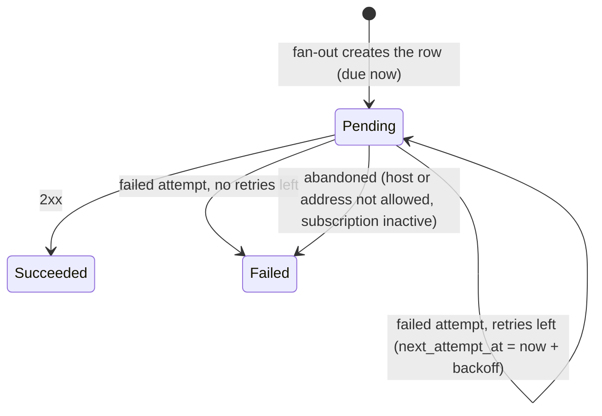

# Architecture

EventRelay accepts events over HTTP and delivers each one to every matching subscriber as a signed
webhook. The design goal is that **an accepted event is never lost** and that every failure mode
ends either in a successful delivery or in a visible, inspectable failure.

## Components

| Component | Process | Responsibility |
| --- | --- | --- |
| `EventRelay.Api` | ASP.NET Core minimal API | Authenticates callers (API keys, two roles), validates and stores events (with an outbox row), manages subscriptions, exposes delivery status |
| `OutboxPublisher` | background service in the API | Publishes outbox rows to the Service Bus topic `events` |
| `EventConsumer` | `EventRelay.Dispatcher` (worker) | Reads the topic subscription `dispatcher`, de-duplicates, matches subscriptions, creates deliveries |
| `DeliveryWorker` | `EventRelay.Dispatcher` (worker) | Claims due deliveries, sends signed webhooks, schedules retries |
| PostgreSQL | – | System of record: events, subscriptions, deliveries, outbox, processed message ids |
| Azure Service Bus | – | Decouples accepting events from processing them; buffers bursts; dead-letter queue |

`EventRelay.Core` holds the domain rules (matching, retry policy, delivery state machine) without
any framework dependency; `EventRelay.Infrastructure` holds EF Core, Service Bus and HTTP code shared
by both processes.

## Flow of one event

```mermaid
sequenceDiagram
    autonumber
    participant P as Producer
    participant A as API
    participant DB as PostgreSQL
    participant SB as Service Bus
    participant C as EventConsumer
    participant W as DeliveryWorker
    participant S as Subscriber

    P->>A: POST /events
    A->>DB: BEGIN; INSERT events; INSERT outbox_messages; COMMIT
    A-->>P: 202 Accepted
    loop every 500 ms
        A->>DB: SELECT … FOR UPDATE SKIP LOCKED (unpublished)
        A->>SB: send batch (MessageId = event id)
        A->>DB: mark published; COMMIT
    end
    SB->>C: message (peek-lock)
    C->>DB: BEGIN; INSERT processed_messages ON CONFLICT DO NOTHING
    C->>DB: match subscriptions; INSERT deliveries; COMMIT
    C->>SB: complete
    loop every second
        W->>DB: claim due deliveries (UPDATE … RETURNING, SKIP LOCKED, lease)
        W->>S: POST webhook + X-Signature
        S-->>W: 2xx / error / timeout
        W->>DB: Succeeded, or next_attempt_at = now + backoff, or Failed
    end
```

## Data model

| Table | Key | Purpose |
| --- | --- | --- |
| `subscriptions` | `id` | Name, `event_types text[]` (GIN index), `filter jsonb`, `webhook_url`, `secret`, `is_active` |
| `events` | `id` (client-supplied or UUIDv7) | Accepted events: type, source, time, `attributes jsonb`, `data jsonb` |
| `outbox_messages` | `id bigint identity` | Messages not yet sent to the broker; partial index on `processed_at IS NULL` |
| `processed_messages` | `(consumer, message_id)` | Broker messages already handled: the idempotent-consumer record |
| `deliveries` | `id`; unique `(event_id, subscription_id)` | Status, attempts, `next_attempt_at` (partial index for pending rows), last status code and error |

`deliveries` references `events` and `subscriptions` with `ON DELETE CASCADE`: deleting a
subscription also removes its pending deliveries.

## Subscription matching

A subscription matches an event when it is active, one of its patterns matches the event type and
every filter entry equals the corresponding attribute.

- `flight.delayed`: exact match
- `flight.*`: any type that starts with `flight.`
- `*`: everything

To avoid loading all subscriptions, the consumer computes every pattern that *could* match the type
(`flight.gate.changed` → `flight.gate.changed`, `flight.gate.*`, `flight.*`, `*`) and selects
candidates with the array-overlap operator (`event_types && @candidates`, served by the GIN index).
The exact decision, including filters, is then made by `SubscriptionMatcher` in Core. A unit test
checks that both views agree.

## Delivery state machine



Claiming is one statement:

```sql
WITH due AS (
    SELECT id FROM deliveries
    WHERE status = 'Pending' AND next_attempt_at <= @now
    ORDER BY next_attempt_at
    LIMIT @batch
    FOR UPDATE SKIP LOCKED)
UPDATE deliveries d
SET attempts = d.attempts + 1, last_attempt_at = @now, next_attempt_at = @now + @lease
FROM due WHERE d.id = due.id
RETURNING d.*;
```

Moving `next_attempt_at` forward acts as a lease: no transaction stays open while webhooks are in
flight, other instances skip the rows, and if this instance crashes the rows become due again when
the lease expires.

Backoff: `min(base · 2^(attempt-1), max) · (1 ± jitter)`, never above `max`.

## What happens when…

| Failure | Effect | Recovery |
| --- | --- | --- |
| Service Bus is down | `POST /events` still succeeds; outbox rows accumulate | Publisher retries every polling interval; rows are sent once the broker is back |
| API crashes after sending to Service Bus but before marking rows published | The batch is sent again later | Consumer finds the message id in `processed_messages` and only acknowledges it |
| Dispatcher crashes during fan-out | Transaction rolls back; message lock expires | Service Bus redelivers; fan-out runs once |
| Database unavailable during fan-out | Handler fails | Message abandoned after a growing pause (2, 4, 8 … 30 s); dead-lettered after 10 deliveries |
| Malformed message or unknown event id | Cannot ever succeed | Dead-lettered immediately with reason `InvalidPayload` / `UnknownEvent` |
| Subscriber returns 5xx, 4xx, 3xx or times out | Attempt failed | Retried with backoff; `Failed` after `MaxAttempts` |
| Dispatcher crashes while webhooks are in flight | Outcome unknown | Lease expires, delivery is retried (subscriber may see a duplicate) |
| Webhook host removed from the allowlist | Pending deliveries to it | Abandoned as `Failed` (`host_not_allowed`) without sending |
| Webhook host resolves to a private, loopback or metadata address | Connection refused before any byte is sent | Abandoned as `Failed` (`address_not_allowed`) |

## Scaling out

- **API**: stateless; several replicas can run `OutboxPublisher` concurrently thanks to
  `FOR UPDATE SKIP LOCKED`.
- **Dispatcher**: competing consumers on the topic subscription; delivery claiming is safe across
  instances for the same reason. Webhook parallelism per instance is bounded by `Delivery:MaxParallelism`.
- **Database**: the polling queries are range scans on small partial indexes that only contain
  pending rows (`ix_outbox_messages_unprocessed`, `ix_deliveries_due`), so they stay cheap as history
  grows. Retention jobs would keep the tables themselves small.
